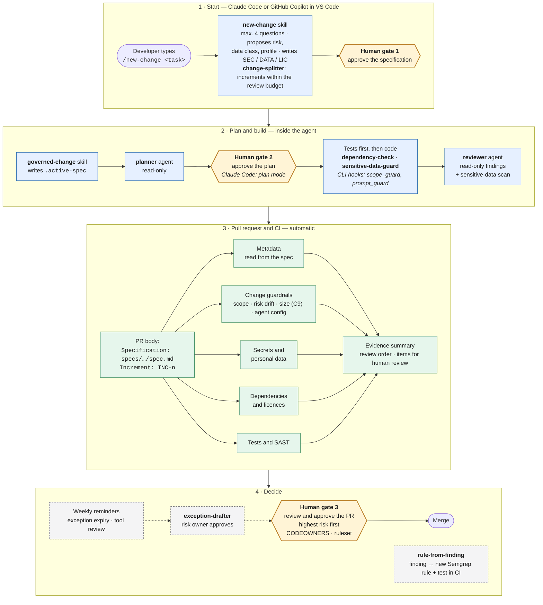

# Governance Framework for Secure and Compliant AI-Assisted Code Generation

A governance framework for software teams that use AI coding assistants and AI agents, with a working reference implementation for **Claude Code** and **GitHub Copilot**.

AI tools write code faster than people can review it. The code can contain insecure patterns, secrets, personal data, invented or unlicensed dependencies, and changes outside the task. The framework decides, for each change, what the AI tool may do, under which conditions, who approves the result and which evidence the team keeps.

> This repository is the practical part of a master's thesis. Chapter 4 of the thesis describes the framework. Chapter 5 reports the evaluation from [`evaluation/`](evaluation/).

## How it works

The governed path is the easiest path. A developer types one command and makes three decisions. Skills, read-only agents and CI do the rest.

<!-- diagram:08-developer-flow -->


_Source: [`docs/diagrams/08-developer-flow.mmd`](docs/diagrams/08-developer-flow.mmd) · image: [SVG](docs/diagrams/08-developer-flow.svg), [PNG](docs/diagrams/08-developer-flow.png)_

The framework has:

- **Two assessments for each change:** a change risk class (Routine, Elevated, High impact, Restricted) and a tool capability profile (P0 Suggest to P3 Connected).
- **Nine core controls** (C1–C9) for every AI-assisted change.
- **Nine agentic extensions** (A1–A9). They apply only when the tool can act: edit files, run commands, use the network, reach credentials or external tools.
- **An honest assurance label** on every control: Enforced, Detected, Advisory or Manual. Nobody mistakes an instruction for a block.

## Documentation

| Read | When you want to |
|---|---|
| **This README** | Get the idea in five minutes |
| [**docs/FRAMEWORK.md**](docs/FRAMEWORK.md) | Understand the whole framework: principles, risk and capability, lifecycle, controls, assurance model, C4 architecture |
| [**docs/INSTALL-AND-USE.md**](docs/INSTALL-AND-USE.md) | Install it in a project and use it every day, on either platform |
| [**docs/TESTING.md**](docs/TESTING.md) | Test it on the sample application and see what is covered and what is not |
| [agent/README.md](agent/README.md) | Platform details: what Claude Code and Copilot can enforce |
| [governance/](governance/) | The normative texts: policy, risk classes, control catalogue, tool register |
| [LIMITATIONS.md](LIMITATIONS.md) | What no test in this repository can establish |
| [docs/thesis-alignment.md](docs/thesis-alignment.md) | How the thesis chapters map to the files here |

## Quick start

```bash
./setup.sh --check                         # check the prerequisites on this machine
./setup.sh /path/to/your/project           # install for Claude Code and GitHub Copilot
python evaluation/run_scenarios.py         # or: see the controls work on the sample application
```

On Windows, use `.\setup.ps1 -Target C:\path\to\project`. Then, in the agent chat of your project:

```text
/new-change add a count of refunded orders per customer
```

## What it is not

The framework does not add a new coding agent, a gateway or an audit service, and it does not give legal advice. A passed check does not prove that a change is secure, correct or compliant. Each result holds only for the tested versions and settings. Read [LIMITATIONS.md](LIMITATIONS.md) before you rely on a result.

## Licence

MIT ([LICENSE](LICENSE)). The [`asd-ste100`](.claude/skills/asd-ste100/) skill is a copy of [danyuchn/asd-ste100-skill](https://github.com/danyuchn/asd-ste100-skill) (MIT). The CI downloads gitleaks (MIT), OSV-Scanner (Apache-2.0) and Semgrep CE (LGPL-2.1) at run time. See [NOTICE.md](NOTICE.md).
