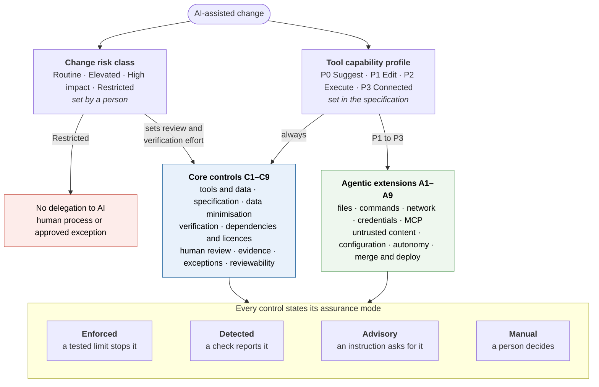
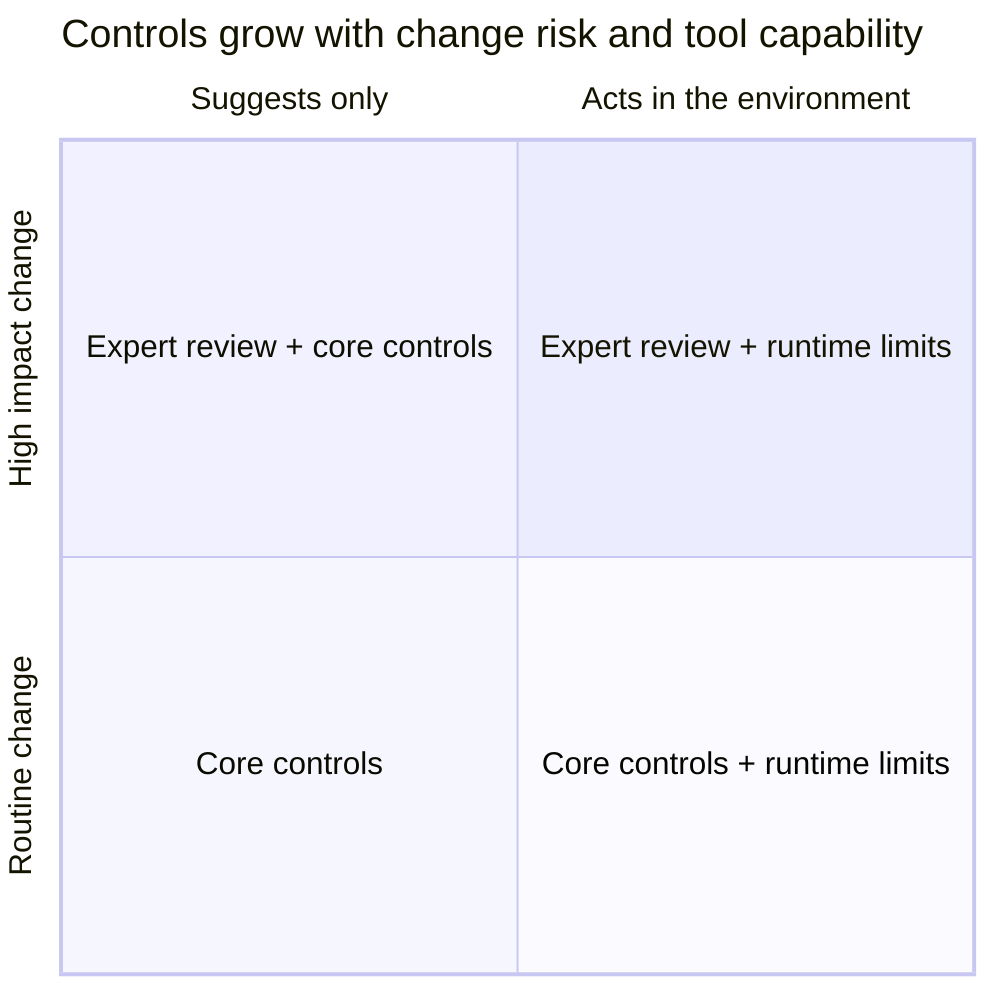
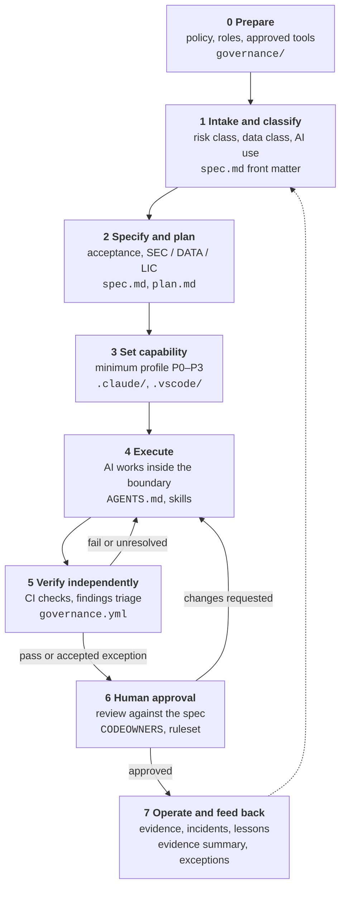
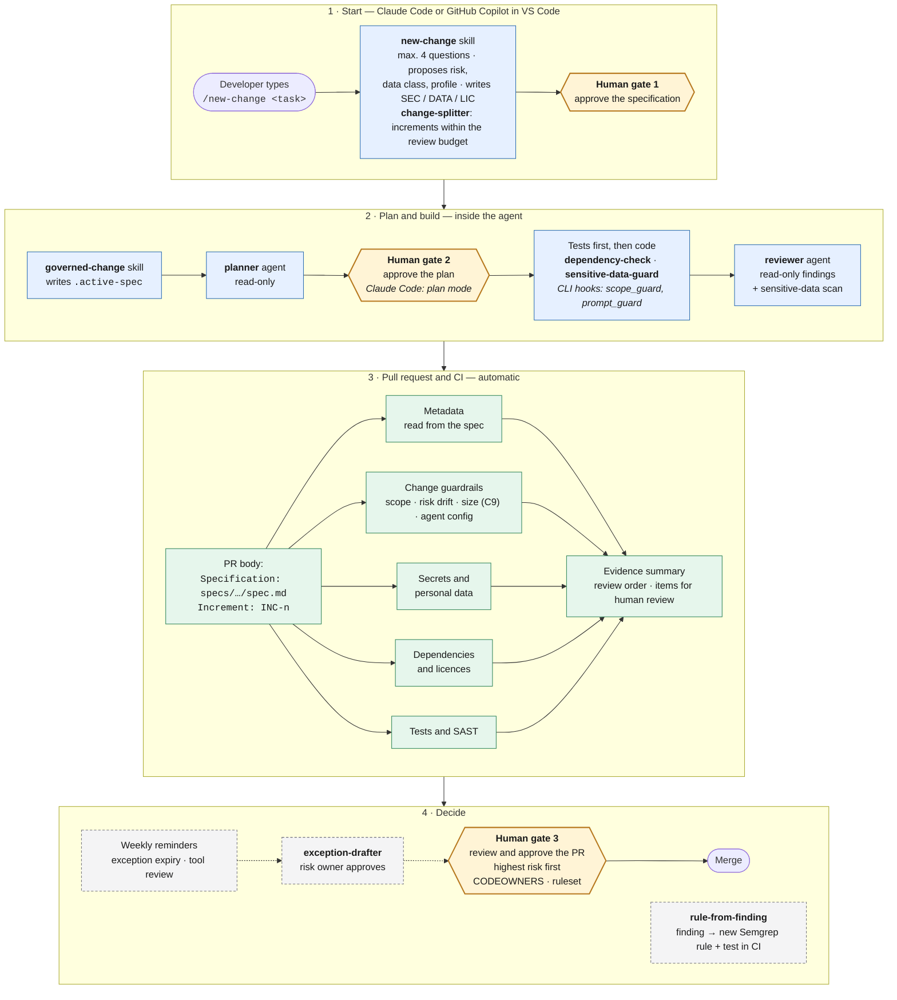
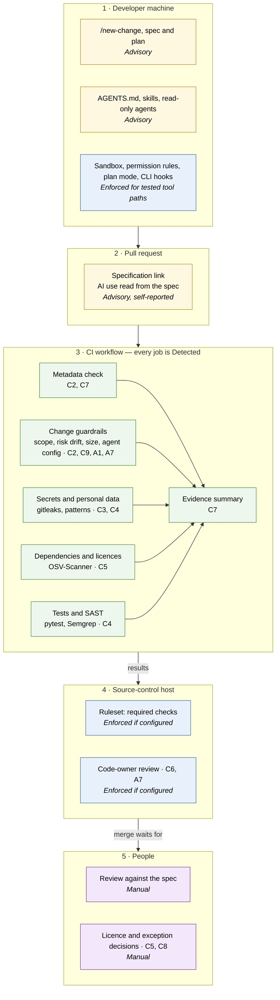
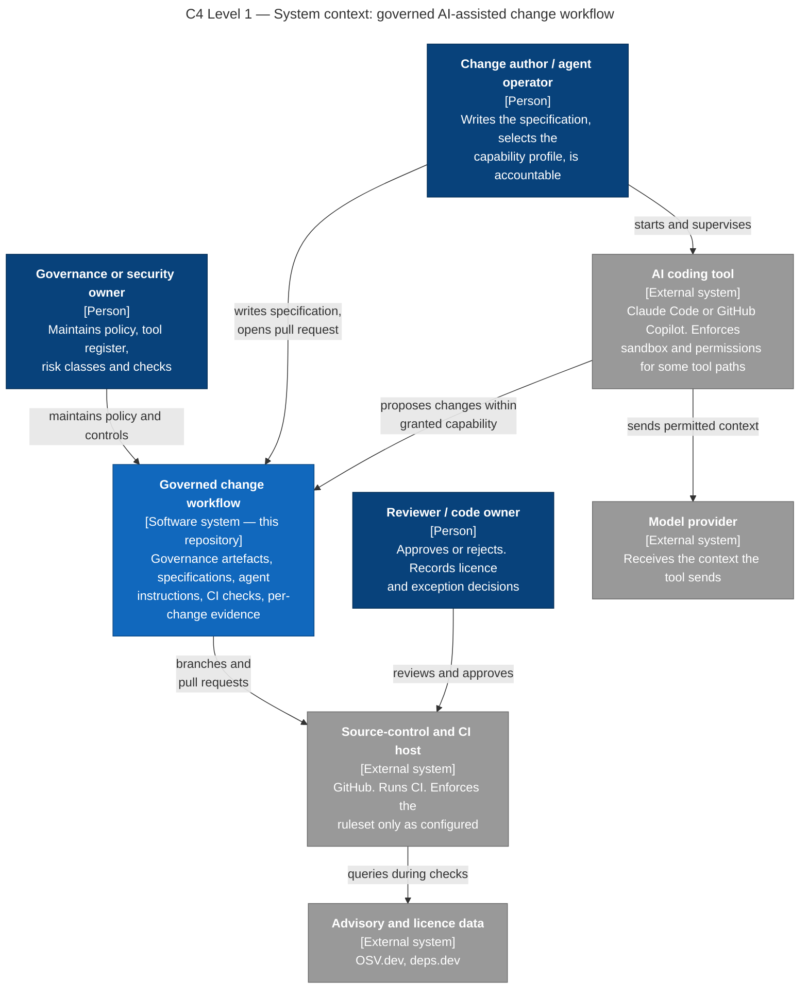
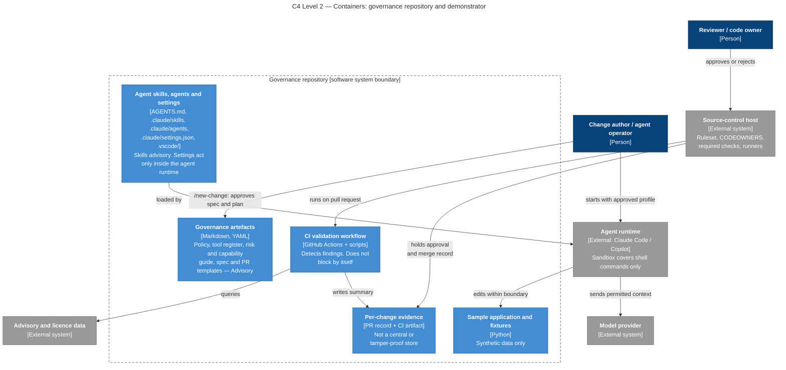
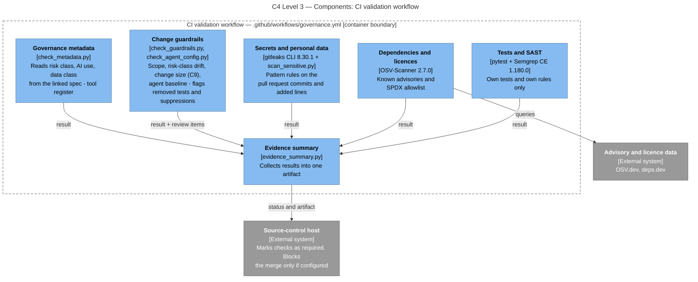

# The Framework in Full

This document describes the governance framework: its two assessment dimensions, the lifecycle, the controls, the assurance model and the reference architecture. For a short introduction, read the [README](../README.md). To install it, read [INSTALL-AND-USE.md](INSTALL-AND-USE.md). To test it, read [TESTING.md](TESTING.md).

The normative texts are in [`governance/`](../governance/): the [policy](../governance/policy.md) with its seven principles, the [risk classes and capability profiles](../governance/risk-and-capability.md) and the [control catalogue](../governance/controls.md). This document explains them and shows how they fit together. If the two differ, `governance/` is correct.

## Contents

- [1. The framework at a glance](#1-the-framework-at-a-glance)
- [2. Two dimensions: change risk and tool capability](#2-two-dimensions-change-risk-and-tool-capability)
- [3. Lifecycle of a governed change](#3-lifecycle-of-a-governed-change)
  - [3.1 Day-to-day flow: three human gates](#31-day-to-day-flow-three-human-gates)
- [4. Controls](#4-controls)
- [5. Assurance model: where each control acts](#5-assurance-model-where-each-control-acts)
- [6. Reference architecture (C4)](#6-reference-architecture-c4)
- [7. Repository map](#7-repository-map)
- [8. Writing style](#8-writing-style)

## 1. The framework at a glance

Every AI-assisted change gets two assessments. A person sets the **change risk class**. The specification sets the **tool capability profile**. The core controls apply to every AI-assisted change. The agentic extensions apply only when the tool can act in the environment. Every control states its assurance mode, so nobody mistakes an instruction for an enforcement.

<!-- diagram:01-framework-overview -->


_Source: [`docs/diagrams/01-framework-overview.mmd`](diagrams/01-framework-overview.mmd) · image: [SVG](diagrams/01-framework-overview.svg), [PNG](diagrams/01-framework-overview.png)_

## 2. Two dimensions: change risk and tool capability

| Change risk class | Typical change | Consequence |
|---|---|---|
| Routine | Documentation, tests, styling. Easy to reverse. | Specification, standard CI checks, one accountable review |
| Elevated | Business logic, dependencies, behaviour that users see | Acceptance criteria, security and dependency checks, technical lead approves the class |
| High impact | Sensitive data, identity and access, cryptography, infrastructure, critical services | Expert review, more verification, tighter agent capabilities |
| Restricted | Prohibited by law, contract or policy, or above the tool's data limit | No delegation to AI. Human process, or an approved exception. |

| Capability profile | The tool can | Extensions that apply |
|---|---|---|
| P0 Suggest | Suggest code from the context that the developer gives | None |
| P1 Edit | Change files in the task workspace | A1, A6, A7 |
| P2 Execute | P1, plus run commands. Network only to approved package sources. | A1–A3, A6–A8 |
| P3 Connected | P2, plus network, external tools or MCP servers | A1–A8 |

No profile lets an agent push to a protected branch, merge, deploy or use production credentials (A4, A9). The risk classes are proposed categories for validation, not an external standard. Details: [governance/risk-and-capability.md](../governance/risk-and-capability.md).

<!-- diagram:07-risk-capability -->


_Source: [`docs/diagrams/07-risk-capability.mmd`](diagrams/07-risk-capability.mmd) · image: [SVG](diagrams/07-risk-capability.svg), [PNG](diagrams/07-risk-capability.png)_

## 3. Lifecycle of a governed change

Stage 0 is continuous. Stages 1–7 repeat for each change. A failed check or a requested change returns the work to execution. Operations feed lessons back into the policy, the templates and the checks. Each stage names the repository artefact that supports it.

<!-- diagram:02-lifecycle -->


_Source: [`docs/diagrams/02-lifecycle.mmd`](diagrams/02-lifecycle.mmd) · image: [SVG](diagrams/02-lifecycle.svg), [PNG](diagrams/02-lifecycle.png)_

| Stage | Decision | Typical owner | Record |
|---|---|---|---|
| 0 Prepare | Approve tools and purposes. Set risk criteria, roles and the exception process. | Governance or security owner | `governance/` |
| 1 Intake and classify | Purpose, impact, data class, permitted AI use | Change author, technical lead | Specification front matter |
| 2 Specify and plan | Acceptance criteria, security, privacy and licence needs, permitted capabilities | Change owner, technical lead | `spec.md`, `plan.md` |
| 3 Set capability | Approved tool and minimum capability profile | Agent operator | `.claude/`, `.vscode/`, profile files |
| 4 Execute | AI works inside the boundary. A human approves anything outside it. | Developer or agent operator | Commits, session record |
| 5 Verify independently | Tests, security, secret, dependency and licence checks | CI and qualified reviewers | CI results on the commit |
| 6 Human approval | Check the change against the specification. Decide on findings and exceptions. | Reviewer, code owner | Approval and merge record |
| 7 Operate and feed back | Monitor, handle incidents, update controls | Service owner, governance owner | Evidence summary, exception records |

### 3.1 Day-to-day flow: three human gates

Design rule: **the governed path must be the easiest path.** A developer does not fill in tables or run scripts. The developer types one command and makes three decisions. Skills, read-only agents and CI do the rest. The same flow works in Claude Code and in GitHub Copilot agent mode in VS Code, because both read the skills and agents in `.claude/`.

<!-- diagram:08-developer-flow -->


_Source: [`docs/diagrams/08-developer-flow.mmd`](diagrams/08-developer-flow.mmd) · image: [SVG](diagrams/08-developer-flow.svg), [PNG](diagrams/08-developer-flow.png)_

| Step | The developer | The agent or CI |
|---|---|---|
| Start | Types `/new-change <task>`. Answers at most four questions. | `new-change` proposes the risk class, data class and profile with reasons. It writes acceptance criteria and SEC, DATA and LIC requirements into a draft specification. `change-splitter` splits a large task into increments that fit the review budget (C9). |
| **Gate 1** | Approves the specification. A technical lead approves Elevated and above. | — |
| Plan | — | `governed-change` calls the read-only `planner` agent. |
| **Gate 2** | Approves the plan. | Claude Code starts in plan mode, so it cannot edit before this. |
| Build | — | Tests first, then code. `dependency-check` checks each new package. `sensitive-data-guard` stops secrets and personal data. The read-only `reviewer` agent compares the change with the specification. |
| Pull request | Opens one pull request per increment. The body needs `Specification: specs/NNN-name/spec.md` and `Increment: INC-n`. | CI reads every other value from the specification. Five required checks run, including the size check. The evidence summary gives a review order (highest risk first) and lists the items that need a person. |
| **Gate 3** | Reviews and approves the pull request. | The ruleset requires the approval and the code owners. |

Skills and agents (details: [agent/README.md](../agent/README.md#2-skills-and-agents)):

| Name | Type | Purpose |
|---|---|---|
| [`new-change`](../.claude/skills/new-change/SKILL.md) | Skill | Intake, risk classification and security requirements. Writes the draft specification. |
| [`governed-change`](../.claude/skills/governed-change/SKILL.md) | Skill | Procedure from the approved specification to the pull request |
| [`planner`](../.claude/agents/planner.md) | Agent, read-only | Writes the plan |
| [`reviewer`](../.claude/agents/reviewer.md) | Agent, read-only | Finds gaps between the change and the specification |
| [`sensitive-data-guard`](../.claude/skills/sensitive-data-guard/SKILL.md) | Skill + scanner | Secrets and personal data. Never prints a value. |
| [`dependency-check`](../.claude/skills/dependency-check/SKILL.md) | Skill + checker | Invented packages, age, licence, advisories |
| [`change-splitter`](../.claude/skills/change-splitter/SKILL.md) | Skill | Splits a large task into increments that fit the review budget (C9) |
| [`rule-from-finding`](../.claude/skills/rule-from-finding/SKILL.md) | Skill | Turns a review finding into a Semgrep rule with a test |
| [`exception-drafter`](../.claude/skills/exception-drafter/SKILL.md) | Skill | Drafts an exception record for the risk owner |
| [`asd-ste100`](../.claude/skills/asd-ste100/SKILL.md) | Skill | Plain-language text |

A weekly workflow ([`governance-reminders.yml`](../.github/workflows/governance-reminders.yml)) opens one issue for exceptions that expire soon and for the tool register review.

## 4. Controls

**Core controls** apply to every AI-assisted change, whether the tool suggests code or acts.

| ID | Control | Implemented here by |
|---|---|---|
| C1 | Approved tool and data-use rules | [`governance/approved-tools.yaml`](../governance/approved-tools.yaml) |
| C2 | Change specification and risk classification | `new-change` skill, [`specs/_template/`](../specs/_template/), [`risk-paths.yaml`](../policy-config/risk-paths.yaml), [`check_metadata.py`](../scripts/check_metadata.py), risk-drift check in [`check_guardrails.py`](../scripts/check_guardrails.py) |
| C3 | Data minimisation and context boundary | [`governance/data-handling.md`](../governance/data-handling.md), `sensitive-data-guard` skill and scanner, gitleaks |
| C4 | Security and quality verification | pytest, Semgrep (own rules), gitleaks, test and suppression flags in [`governance.yml`](../.github/workflows/governance.yml), `rule-from-finding` |
| C5 | Dependency and licence review | `dependency-check` skill, OSV-Scanner, [`allowed-licenses.txt`](../policy-config/allowed-licenses.txt), human decision |
| C6 | Accountable human review | [`CODEOWNERS`](../.github/CODEOWNERS), [`ruleset.json`](../.github/ruleset.json), [review checklist](review-checklist.md) |
| C7 | Change disclosure and evidence | Specification front matter, [`evidence_summary.py`](../scripts/evidence_summary.py) |
| C8 | Exception and feedback process | `exception-drafter` skill, [`exception-template.md`](../governance/exception-template.md), expiring entries in [`osv-scanner.toml`](../policy-config/osv-scanner.toml), weekly reminders |
| C9 | Reviewability gate | [`review-budget.yaml`](../policy-config/review-budget.yaml), size check in [`check_guardrails.py`](../scripts/check_guardrails.py), increments in the specification, `change-splitter` skill, suggested review order |

**Agentic extensions** apply when the tool has the capability. The capability starts the extension, not the product name.

| ID | Capability trigger | Implemented here by |
|---|---|---|
| A1 | Agent can modify files | Claude Code sandbox and permission rules. VS Code agent sandbox (preview). Scope check in CI. `scope_guard.py` hook (Claude Code CLI). |
| A2 | Agent can run commands | Deny and ask rules (Claude Code). Terminal approval rules (Copilot). |
| A3 | Agent can access a network | Sandbox domain allowlist. Copilot cloud agent firewall. |
| A4 | Agent can access credentials | `sandbox.credentials`, `Read` deny rules, denied paths. `prompt_guard.py` hook (Claude Code CLI). |
| A5 | Agent can use external tools or MCP servers | Reference only: [`docs/extensions/mcp.md`](extensions/mcp.md). CI fails if `.mcp.json` appears. |
| A6 | Agent reads untrusted content | [`AGENTS.md`](../AGENTS.md) (advisory). Containment through A1–A3. |
| A7 | Agent configuration affects behaviour | Code-owner review of `AGENTS.md`, `.claude/`, `.vscode/`, `agent/`. [`check_agent_config.py`](../scripts/check_agent_config.py) against [`agent-baseline.yaml`](../policy-config/agent-baseline.yaml). |
| A8 | Agent does multi-step work | Plan mode by default (Claude Code). Read-only `planner` agent. Plan approval in `governed-change`. |
| A9 | Agent can push, merge or deploy | `git push` deny rule, ruleset without bypass |

The full tables, with responsible roles and limitations, are in [governance/controls.md](../governance/controls.md). Platform details for Claude Code and GitHub Copilot are in [agent/README.md](../agent/README.md).

## 5. Assurance model: where each control acts

Each control has one or more assurance modes:

| Mode | Meaning |
|---|---|
| **Enforced** | A technical limit stops the action. Claim it only after a test. |
| **Detected** | A check reports the condition. The merge stops only if the check is required. |
| **Advisory** | An instruction or template asks for the behaviour. It does not prevent the opposite. |
| **Manual** | A person decides. |

The diagram shows where each control acts on the path of a change. Instructions and templates guide. CI detects. The host enforces the merge rules. People decide.

<!-- diagram:03-control-points -->


_Source: [`docs/diagrams/03-control-points.mmd`](diagrams/03-control-points.mmd) · image: [SVG](diagrams/03-control-points.svg), [PNG](diagrams/03-control-points.png)_

Two qualifications matter most:

- **Agent sandboxes cover some tool paths only.** The Claude Code sandbox covers Bash commands. Its file tools use permission rules. The VS Code agent sandbox is preview. State A1–A3 as enforced only for the tested tool path, version, operating system and settings.
- **Scanners detect. The host blocks.** A failed CI job stops a merge only when the ruleset marks it as required and nobody can bypass the ruleset.

## 6. Reference architecture (C4)

The workflow and its governing artefacts form the system boundary. The AI tool, the model provider, the source-control host and the advisory data sources are external systems. Their enforcement depends on the selected product and configuration. The views use C4 notation. They are drawn as Mermaid flowcharts, because the Mermaid C4 syntax is experimental and its layout overlaps labels.

### Level 1 — System context

<!-- diagram:04-c4-context -->


_Source: [`docs/diagrams/04-c4-context.mmd`](diagrams/04-c4-context.mmd) · image: [SVG](diagrams/04-c4-context.svg), [PNG](diagrams/04-c4-context.png)_

### Level 2 — Containers

<!-- diagram:05-c4-container -->


_Source: [`docs/diagrams/05-c4-container.mmd`](diagrams/05-c4-container.mmd) · image: [SVG](diagrams/05-c4-container.svg), [PNG](diagrams/05-c4-container.png)_

No gateway, central evidence store, dashboard or MCP server is part of the baseline. Evidence stays in the pull request and the CI artifact.

### Level 3 — Components of the CI validation workflow

<!-- diagram:06-c4-component-ci -->


_Source: [`docs/diagrams/06-c4-component-ci.mmd`](diagrams/06-c4-component-ci.mmd) · image: [SVG](diagrams/06-c4-component-ci.svg), [PNG](diagrams/06-c4-component-ci.png)_

Each component detects and reports. The host blocks a merge only for checks that the ruleset requires. Images of all diagrams (SVG and PNG) are in [`docs/diagrams/`](diagrams/).

## 7. Repository map

```text
.
├── README.md                     Short introduction and links to the four guides
├── LIMITATIONS.md                What no test here can establish
├── AGENTS.md, CLAUDE.md          Agent instructions (advisory)
├── governance/                   Policy, risk and capability guide, tool register, controls, data handling, exceptions
├── specs/                        Specification and plan templates, worked example 001, evaluation spec 900
├── docs/                         FRAMEWORK, INSTALL-AND-USE, TESTING, review checklist, evidence format,
│                                 thesis alignment, extensions (MCP, spec toolkits), diagrams
├── setup.sh, setup.ps1           Install the framework into a project (both platforms)
├── agent/                        Platform notes and capability profiles for Claude Code and GitHub Copilot
├── .claude/skills/               Eight skills for both platforms (new-change, governed-change, sensitive-data-guard, ...)
├── .claude/agents/               Read-only planner and reviewer agents for both platforms
├── .claude/settings.json, hooks/ Claude Code: plan mode, permission rules, sandbox, CLI hooks
├── .vscode/                      GitHub Copilot agent-mode settings
├── .github/                      Workflows (checks, weekly reminders), PR template, CODEOWNERS, importable ruleset
├── scripts/                      Metadata, guardrail, agent-config, evidence and reminder scripts
├── policy-config/                Semgrep rules, gitleaks config, licence allowlist, OSV-Scanner exceptions, risk paths, agent baseline
├── sample-app/                   Synthetic order store: orders (Elevated), auth (High impact), docs (Routine), 22 tests
├── tests/                        Tests for the scripts and the Semgrep rules
└── evaluation/                   Protocol, fixtures, local runner, GitHub scenario script, results
```

## 8. Writing style

Governance text must be hard to misread. The documentation follows Simplified Technical English (ASD-STE100) in its STE-flavored form: short sentences, active voice, one instruction per sentence, no semicolons. Agent instructions use the strict form.

- The [`asd-ste100`](../.claude/skills/asd-ste100/SKILL.md) skill rewrites text in this style. Agents use it for pull request summaries. Authors can use it for specifications.
- The CI job `Documentation style (advisory)` runs the skill's linter on the documentation. It reports findings but never blocks a merge.

The skill applies the structural rules of the standard. It does not contain the official ASD-STE100 dictionary, so the documentation does not claim dictionary compliance.
