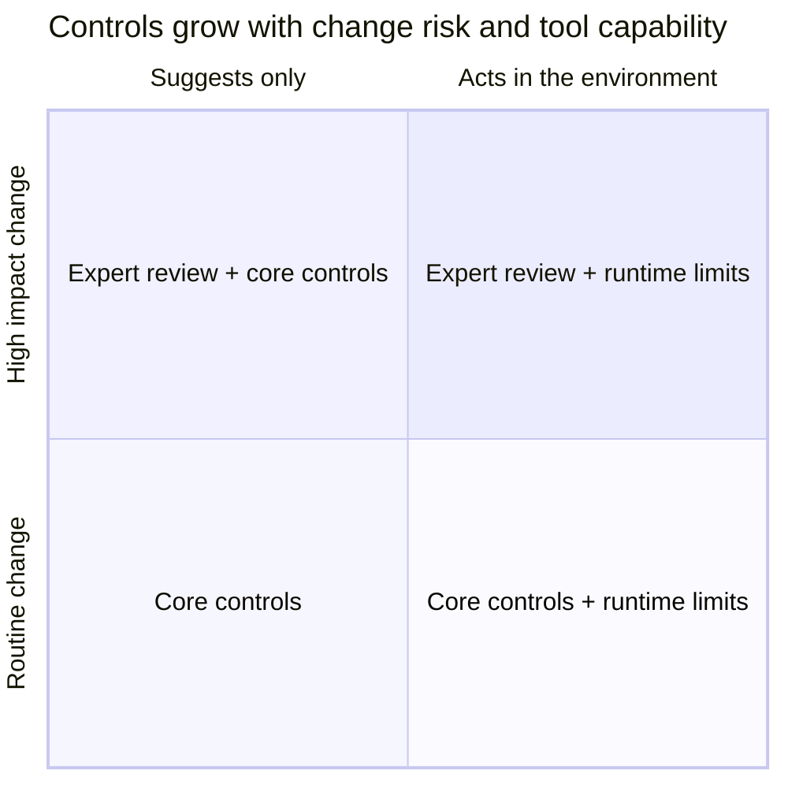

# Risk Classes and Capability Profiles

The framework uses two separate assessments for each change:

- **Change risk:** what can go wrong if the change is wrong, insecure or not compliant.
- **Tool capability:** what the AI tool can do in the task environment.

Controls increase when the risk increases or when the tool gets more capabilities. A person classifies the risk. An AI agent does not.

The risk classes are proposed categories for validation. They are not a measurement scale and not an external standard.

## 1. Change-risk classes

| Class | Typical change | Governance consequence |
|---|---|---|
| **Routine** | Low impact. Easy to reverse. Uses data that is not sensitive. Examples: documentation, tests, internal tooling text, styling. | Follow the specification. Run the standard CI checks. Get one accountable review. |
| **Elevated** | Changes business logic, dependencies or behaviour that users can see. | Write acceptance criteria. Run the security checks and the dependency check. The technical lead approves the class. |
| **High impact** | Touches sensitive data, identity and access management, cryptography, infrastructure or critical services. | Get a review from a person with the right expertise. Increase verification. Restrict agent capabilities when an agent takes part. |
| **Restricted** | Not permitted by law, contract or policy, or outside the risk limits of the available tool. | Do not delegate to AI. Use the normal human process, or get an approved exception. |

### How to choose the class

1. Ask the questions below. Each "yes" sets a minimum class.
2. Use the highest class that you found.
3. When you are not sure between two classes, use the higher class.

| Question | Minimum class |
|---|---|
| Does the change modify business logic, a dependency or user-visible behaviour? | Elevated |
| Does the change touch personal data, credentials, authentication, authorisation, cryptography, infrastructure or a critical service? | High impact |
| Is the change hard to reverse (data migration, deletion, external commitment)? | High impact |
| Do a law, a contract or this policy prohibit AI use for this work? | Restricted |
| Does the task need data above the class that the tool may receive (see `approved-tools.yaml`)? | Restricted |

A risk class informs the review and the verification. A risk class does not give an agent any permission. Permissions come from the capability profile.

## 2. Capability profiles

A capability profile states which capabilities the tool may use for one task. Record the profile in the specification. Enable only the capabilities that the task needs. Treat the environment as untrusted.

| Profile | Capabilities enabled | Extensions that apply |
|---|---|---|
| **P0 Suggest** | Reads the context that the developer gives. Suggests code. Cannot change files or run commands. | None. Core controls only. |
| **P1 Edit** | Reads and modifies files in the task workspace. | A1, A6, A7 |
| **P2 Execute** | P1, plus runs commands in the workspace. No network except approved package sources. | A1, A2, A3, A6, A7, A8 |
| **P3 Connected** | P2, plus network access, external tools or MCP servers. | A1–A8 |

No profile allows an agent to push to a protected branch, to merge, to deploy or to use production credentials (A4, A9).

### Capability triggers

| ID | Capability trigger | Additional control |
|---|---|---|
| A1 | Agent can modify files | Restrict writing to the task workspace. Deny access to credentials, git hooks and governance configuration unless a person authorises it. |
| A2 | Agent can run commands | Limit the commands. Get approval before the agent installs or removes software, changes privileges or does other high-impact tasks. |
| A3 | Agent can access a network | Use no network or an approved allowlist. Use approved package sources. |
| A4 | Agent can access credentials or privileged environment variables | Do not expose production credentials. Use short-lived test credentials only when the task needs them. |
| A5 | Agent can use external tools, plugins or MCP servers | Deny by default. Approve specific servers and tools. Limit permissions. Review the data handling. Do not pass tokens through. |
| A6 | Agent reads issues, documents, web pages, repository files or tool output | Treat this content as untrusted data. This content cannot authorise a privileged operation. |
| A7 | Agent configuration or instruction files affect its behaviour | Protect changes to instructions, workflow configuration and permission profiles with code-owner review. |
| A8 | Agent does multi-step or autonomous work | The operator can monitor, stop the work and approve any capability increase. Record the activity without unnecessary sensitive content. |
| A9 | Agent can push, merge, deploy or affect production | Deny these abilities by default. Require human approval and the normal release process. |

## 3. Risk and capability together

Assess both dimensions together. Two examples:

- A **High impact** change can need a strict human review even when the AI only suggests code (P0).
- An agent with **P2 Execute** needs runtime limits even for a **Routine** change.

## 4. Platform enforcement

A capability profile states what you intend. It holds only where a platform enforces it. See [agent/README.md](../agent/README.md) for what Claude Code and GitHub Copilot can enforce, and for which tool paths. An agent sandbox can cover shell commands only. File-edit tools, hooks and MCP processes can follow separate rules. State A1–A3 as enforced only for the tested tool path, platform version, operating system and configuration.
